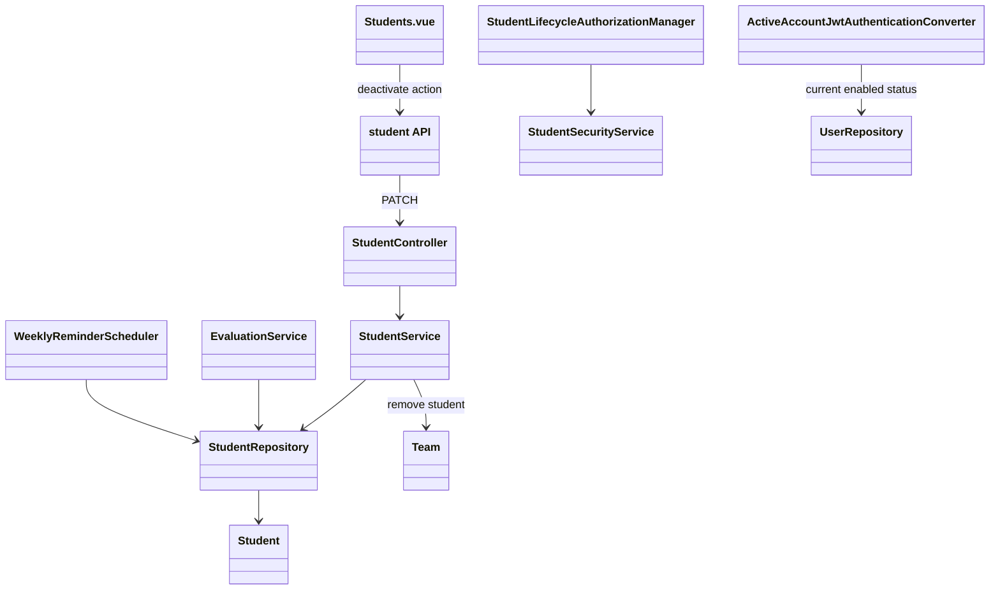
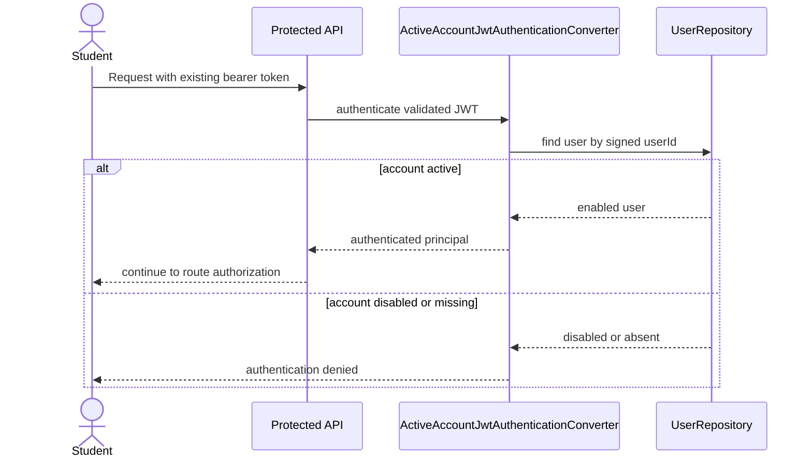

# Student Design

> Realizes: [UC-STU-deactivate-student](../requirements/use-cases.md#uc-stu-deactivate-student-the-course-admininstructor-deactivates-a-student)
> Depends on FRs: `FR-SEC-authorization`, `FR-SEC-deny-unauthorized`, `FR-SEC-active-account`
> See: [architectural-design.md](architectural-design.md) (Container and foundation component views), [SRS Business Domain Model](../requirements/software-requirements-specification.md#business-domain-model)

## Overview

Student deactivation extends the existing `student` bounded context in the shared foundation. It adds no new persisted state: `Student.enabled` and the nullable `Student.team` relationship represent the lifecycle change. The operation also relies on shared security to reject already-issued JWTs for disabled accounts and adjusts peer-evaluation reporting and weekly reminders to honor the lifecycle rules.

## Components & classes

| Component | Status | Responsibility |
|---|---|---|
| [Students.vue](../../frontend/src/pages/students/Students.vue), [EditStudentForm.vue](../../frontend/src/pages/students/EditStudentForm.vue), [student API](../../frontend/src/apis/student/index.ts) | Reused and extended | Expose a dedicated confirmation action; ordinary student edits no longer change `enabled`. |
| [StudentController.java](../../backend/src/main/java/team/projectpulse/student/StudentController.java) | Reused and extended | Add `PATCH /students/{studentId}/deactivate`. |
| [StudentService.java](../../backend/src/main/java/team/projectpulse/student/StudentService.java) | Reused and extended | Perform the idempotent lifecycle change in the existing transaction boundary. |
| [StudentRepository.java](../../backend/src/main/java/team/projectpulse/student/StudentRepository.java), [Student.java](../../backend/src/main/java/team/projectpulse/student/Student.java), [Team.java](../../backend/src/main/java/team/projectpulse/team/Team.java) | Reused | Persist the existing enabled flag and clear the team association through `Team.removeStudent`. |
| [StudentLifecycleAuthorizationManager.java](../../backend/src/main/java/team/projectpulse/security/authorizationmanagers/StudentLifecycleAuthorizationManager.java) | New | Authorize only the owning course admin or an instructor assigned to the student's course section; reject self-deactivation. |
| [StudentSecurityService.java](../../backend/src/main/java/team/projectpulse/student/StudentSecurityService.java), [SecurityConfiguration.java](../../backend/src/main/java/team/projectpulse/security/SecurityConfiguration.java) | Reused and extended | Resolve lifecycle authorization and bind it to the dedicated route. |
| `ActiveAccountJwtAuthenticationConverter` in `security/` | New | Reload the JWT subject's persisted user status during each bearer-token authentication. |
| [EvaluationService.java](../../backend/src/main/java/team/projectpulse/evaluation/EvaluationService.java), [WeeklyReminderScheduler.java](../../backend/src/main/java/team/projectpulse/system/WeeklyReminderScheduler.java) | Reused and extended | Preserve report rows only when evaluations exist and exclude inactive or unteamed students from missing-submission lists and reminder recipients. |



## Sequence

The route guard runs before the controller; a denied or self-targeted request never reaches the service. A repeated request is a successful no-op, so the warning and status remain consistent without restoring any previous team assignment.

```mermaid
sequenceDiagram
    actor Admin as Course admin or assigned instructor
    participant UI as Students.vue
    participant API as StudentController
    participant Guard as StudentLifecycleAuthorizationManager
    participant Rules as StudentSecurityService
    participant Service as StudentService
    participant DB as StudentRepository
    participant Student
    participant Team

    Admin->>UI: Confirm deactivation
    UI->>API: PATCH /students/{studentId}/deactivate
    API->>Guard: authorize studentId
    Guard->>Rules: check course ownership or section assignment; reject self
    Rules-->>Guard: permit or deny
    alt unauthorized
        Guard-->>UI: access denied; no state change
    else authorized
        API->>Service: deactivateStudent(studentId)
        Service->>DB: load Student
        alt already disabled
            Service-->>API: unchanged result
        else active
            Service->>Student: set enabled=false
            opt Student has a team
                Service->>Team: removeStudent(Student)
            end
            Service->>DB: save Student
            Service-->>API: changed result
        end
        API-->>UI: Result envelope and status message
    end
```

For any subsequent protected request, including one carrying a JWT issued before deactivation, the shared converter reads the signed user ID, reloads the persisted account, and rejects a missing or disabled account before route authorization.



## Key decisions

- The route-specific authorization permits the course admin who owns the student's course or an instructor assigned to the student's course section. The ordinary user-ownership rule is not reused because it does not express this lifecycle permission; the student may not deactivate herself.
- The service changes `enabled` and clears team membership atomically. It does not delete the student, weekly activity reports, or saved peer evaluations. Reactivation remains out of scope and does not restore a former team assignment.
- Generic student editing must not toggle `enabled`; the dedicated route is the only deactivation path.
- JWT account status is checked during every bearer-token authentication. This uses the existing stateless resource-server path and closes the stale-token access gap without introducing token revocation state; the trade-off is one persisted-user lookup per authenticated request.
- Peer-evaluation reports retain a former teammate only for weeks with saved evaluations and omit her from missing-submission lists. Weekly reminders include only active students currently assigned to a team.

## Data model

No schema change or migration. The existing `Student.enabled` field and optional `Student.team` association carry the change; submitted work and peer-evaluation rows remain intact. See the [SRS Business Domain Model](../requirements/software-requirements-specification.md#business-domain-model).

## Tests

| Scenario | Planned test | Expected evidence |
|---|---|---|
| Active student deactivated by her course admin or assigned instructor | `StudentIntegrationTest` | Account becomes disabled; team membership is cleared; saved work remains. |
| Owning course admin is not assigned to the student's course section | `StudentIntegrationTest` | Deactivation is permitted. |
| Unassigned instructor, non-owning course admin, or student self-deactivation | `StudentIntegrationTest` | Request is denied and neither account nor team state changes. |
| Student is already deactivated | `StudentServiceTest` | Operation reports the existing state and makes no change. |
| Actor cancels at the confirmation warning | Cypress student-management flow | No request is sent and no state changes. |
| Student uses a previously issued JWT after deactivation | `StudentIntegrationTest` | A protected request is denied before reaching its controller. |
| Peer-evaluation reports after team removal | `EvaluationServiceTest` | Historical rows appear only for weeks with saved evaluations; the student is absent from missing-submission lists. |
| Weekly reminders after deactivation or team removal | `WeeklyReminderSchedulerTest` | No reminder is sent to the inactive or unteamed student. |
| Generic student update includes a changed `enabled` value | `StudentServiceTest` | The lifecycle flag is unchanged. |

